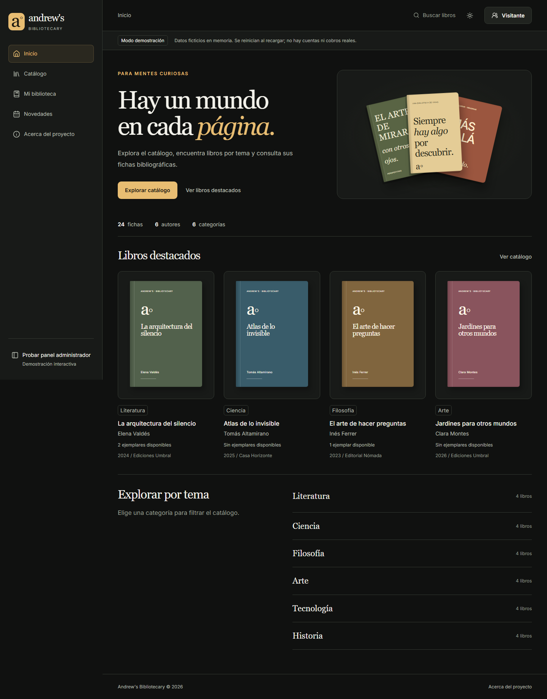

# Andrew's Bibliotecary 3.0

Una biblioteca con circulación completa en Laravel y una demo editorial que permite explorar el recorrido de lectura sin cuentas ni infraestructura de servidor.



## Ver la demo en tiempo real

Requiere Node.js 22.12+; el proyecto se verifica con Node 24.

```sh
npm ci
npm run dev
```

Abre [127.0.0.1:4173](http://127.0.0.1:4173). Los cambios se reflejan al guardar. La demo no necesita PHP, Composer, Docker, MySQL ni claves privadas.

Para el artefacto estático:

```sh
npm run build
npm run preview
```

Elige **Lucía · Lectora**, solicita un libro y consulta **Mi biblioteca**. Cambia a **Mateo · Biblioteca** para preparar y confirmar la entrega. Regresa a Lucía para renovar; Biblioteca recibe la devolución. Las fechas, el historial y la disponibilidad cambian con el recorrido. [Guía de la demo](docs/21_DEMO_CIRCULACION.md).

El selector es un cambio de personaje ficticio, **no autenticación**. Solicitudes, préstamos, cargos y pagos son simulaciones en memoria de esta pestaña; se reinician al recargar. No se mueve dinero. Solo la preferencia de tema puede persistir. Las 24 fichas, sus autorías, descripciones y editoriales son ficticias; no incluyen libros completos para leer o descargar.

## Dos aplicaciones, un lenguaje visual

| Área | Demo estática | Laravel |
|---|---|---|
| Catálogo y fichas | Búsqueda, categorías, orden, paginación y portadas editoriales | Catálogo público, disponibilidad agregada, ISBN, edición e idioma |
| Lectura | Perfiles ficticios y Mi biblioteca | Registro, sesión, membresía y cuenta privada |
| Circulación | Solicitar, validar, preparar, entregar, renovar, devolver y cancelar | Operaciones persistentes, políticas configurables, transacciones y exclusión de préstamos simultáneos |
| Reservas | Lista aprobada, siguiente ejemplar y reloj controlado | FIFO, caducidad, liberación programada y avisos internos |
| Finanzas | Ejemplo de mora, pago manual y reversión | Cargos exactos, abonos, ajustes, pagos, reversiones e informes |
| Administración | Fichas e inventario de muestra; seis ejemplares | Socios, inventario, usuarios, roles, políticas, historial y paneles basados en su base de datos |
| Novedades | Anuncios ficticios y filtros por tema, estado y fecha | Incorporaciones gestionadas por personal, con fechas separadas y disponibilidad real |

Se conservan verde oscuro, negro, ámbar, tipografía editorial y portadas propias. Hay tema claro, navegación por teclado y alternativas para movimiento reducido. **No hay Three.js, WebGL ni vista 3D**; la cubierta utiliza CSS.

```text
demo/                         React + TypeScript + Vite, con estado ficticio
modern/                       Laravel 13 / PHP 8.4 / React 19 / Inertia 3 / MySQL 8.4
modern/resources/js/components/ Portadas, controles, noticias y presentación compartidos
docs/                         Dominio, guías, auditorías y cuatro capturas representativas
```

## Aplicación con servidor

Con Docker Desktop y Node disponibles:

```powershell
# Solo en una base nueva destinada a demostración:
./modern/scripts/install.ps1 -Demo
```

La muestra 3.0 protege los datos existentes: solo admite entornos locales/de prueba, una base sintética compatible y el permiso explícito de seeding. No convierte una base real en una demo. Para actualizar una instalación existente, usa el procedimiento con respaldo de [operación de Laravel](modern/README.md).

Laravel dispone de autorización real comprobada en servidor; el bibliotecario atiende circulación, socios e inventario, y el administrador añade roles, políticas y tesorería. [Guía de lector y personal](docs/23_GUIA_DE_USO_3.md). [Dominio y modelo de datos](docs/16_DOMINIO_BIBLIOTECARIO_3.md).

## Calidad reproducible

```sh
npm run test:domain
npm run build
npm run security:check
npm audit
npm run test:install
npm test
```

Playwright usa el artefacto de producción en `127.0.0.1:4174` y navegadores guardados en `.local/browsers`. Comprueba los recorridos completos, recargas profundas, acciones táctiles, teclado, reflujo a 320 px, temas y movimiento reducido. La prueba del filtro observa el desplazamiento de una tarjeta conservada; no presenta muestreo rAF como FPS.

Para Laravel:

```powershell
./modern/scripts/test.ps1 -KeepTestServer
```

Incluye SQLite en memoria, MySQL de pruebas separado, PHPStan, TypeScript, build, auditorías y Playwright. El script detiene el MySQL efímero sin eliminar los volúmenes existentes; sus pruebas no se dirigen a la base principal. [Resultados, cobertura y límites](docs/22_RESULTADOS_Y_LIMITES_3.md). [Registro por etapas](docs/17_IMPLEMENTACION_3.md). [Limpieza y trazabilidad de publicación](docs/25_PUBLICACION_LIMPIA.md).

## Vercel e historia

Vercel debe compilar **desde la raíz** con `npm ci`, build `npm run build` y salida `dist`. `vercel.json` conserva el fallback SPA y las cabeceras de seguridad. El artefacto contiene exclusivamente la demo; Laravel no se publica como sitio estático. La URL pública se añadirá tras un despliegue autorizado y verificado. [Preparación del PR y publicación](docs/24_PREPARACION_PUBLICACION_3.md).

La rama de publicación es `codex/publicacion-bibliotecary-3`. El desarrollo completo y sus artefactos se conservan localmente en `codex/bibliotecary-3`.  La base 2.6 se conserva en `codex/ux-role-clarity-2.6` (`827be7c`); la recuperación 2.0, en `codex/bibliotecary-2`. `archive/legacy-v1` y `v1-legacy-final` conservan el legado desde `372dbf3`. No se reescribe el historial ni se mueven esas referencias. La documentación de portada se actualiza; el código ejecutable original permanece recuperable e intacto.

El PHP antiguo está fuera de la estructura activa de esta rama y del artefacto de Vercel. Sigue recuperable en el commit histórico de `main` y las referencias locales conservadas. Una publicación futura de Laravel debe utilizar `modern/public/` como document root. No se debe servir la raíz del repositorio como aplicación PHP.

## Licencia

[GPL-3.0-only](LICENSE). Los avisos de 44 dependencias de ejecución se distribuyen en `/licenses/THIRD_PARTY_NOTICES.txt`; se mantienen sus licencias originales. Los inventarios se pueden regenerar con los scripts de licencias; se conservan como artefactos locales.
