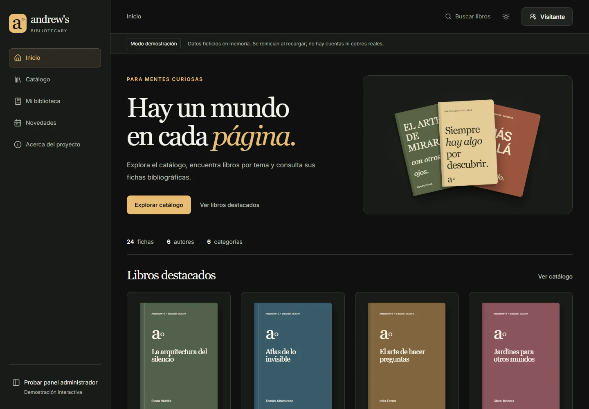
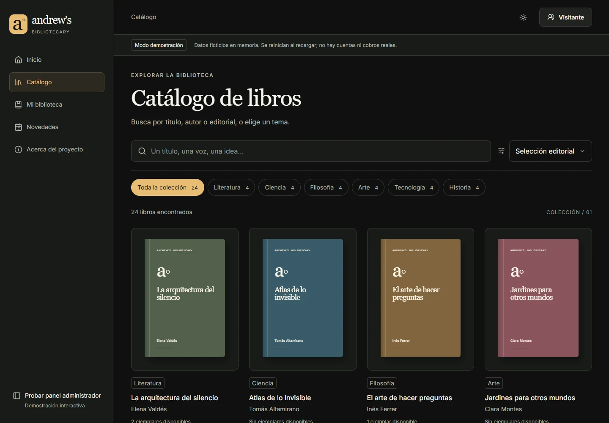
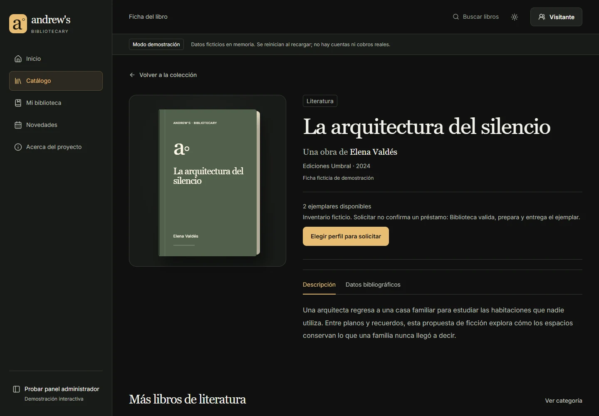
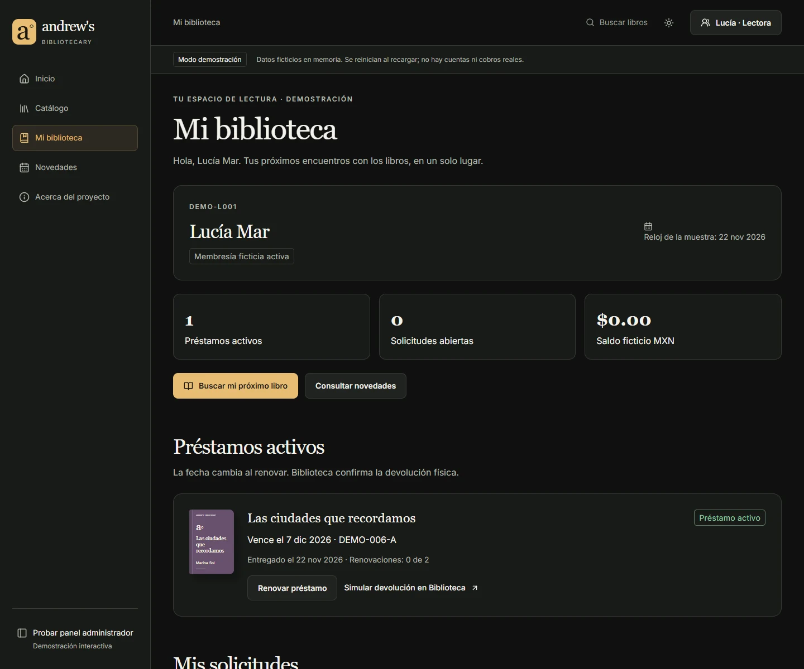
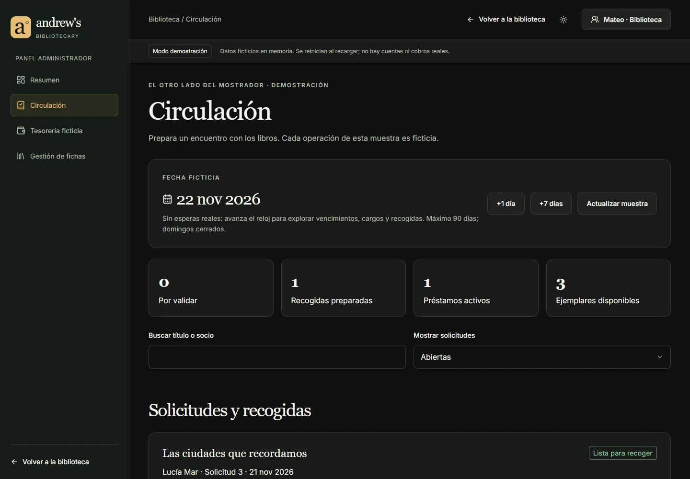
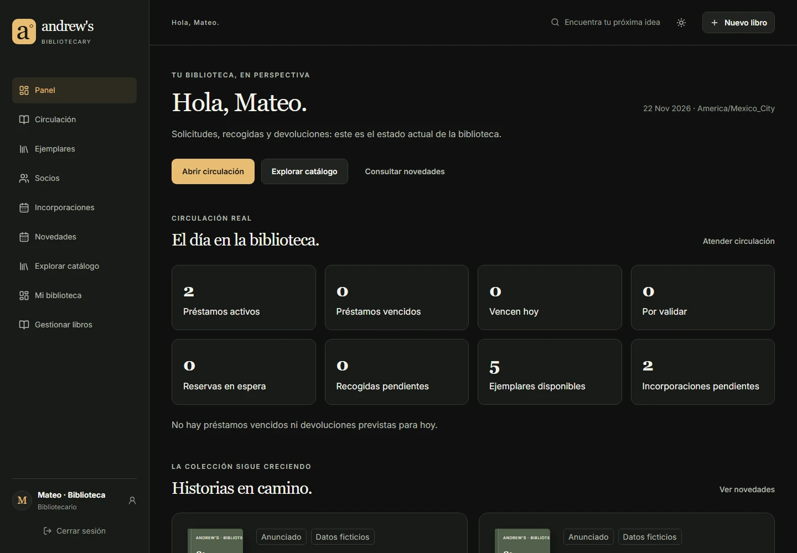

# Andrew's Bibliotecary 3.0

Sistema bibliotecario en español para consultar fichas, gestionar ejemplares y socios, atender préstamos y registrar movimientos financieros. Incluye una aplicación Laravel con operaciones persistentes y una demo React que permite explorar el recorrido completo sin instalar un backend.

**[Explorar la demo pública en Vercel](https://andrews-bibliotecary.vercel.app)** · [Guía de la demo](docs/21_DEMO_CIRCULACION.md) · [Guía de lector y personal](docs/23_GUIA_DE_USO_3.md)



## Qué puedes hacer

- Buscar, filtrar y consultar fichas bibliográficas; distinguir un título de sus ejemplares físicos.
- Solicitar un libro, preparar la recogida, confirmar la entrega, renovar y registrar la devolución.
- Gestionar reservas en espera, plazos de recogida, vencimientos e historial.
- Consultar cargos y saldos; registrar pagos manuales, ajustes y reversiones trazables.
- Administrar socios, inventario, novedades e incorporaciones. En Laravel, también usuarios, permisos y políticas bibliotecarias.

El catálogo contiene fichas bibliográficas: no ofrece los textos completos de los libros para leer o descargar. No se integra una pasarela de pago ni se cobra dinero en línea.

## Demo estática y aplicación Laravel

Comparten tipografía, portadas, estilos y componentes de presentación, pero son ejecuciones independientes.

| | Demo pública | Aplicación Laravel |
|---|---|---|
| Interfaz | React 19, TypeScript, Vite y Motion | React 19, TypeScript e Inertia 3 |
| Ejecución | Archivos estáticos alojados en Vercel | Laravel 13, PHP 8.4 y MySQL 8.4 |
| Datos | Colección ficticia y estado en memoria de la pestaña | Datos persistentes en la base configurada |
| Acceso | Selector de perfiles ficticios, sin autenticación | Registro, sesión y autorización comprobada en el servidor |
| Operaciones | Simulación de los recorridos principales | Validación, políticas, transacciones y auditoría reales |
| Disponibilidad actual | Pública, sin crear una cuenta | Instalación local; backend aún sin despliegue público |

La demo no envía operaciones a Laravel, PHP ni MySQL. **Visitante, Lucía, Nora, Mateo y Andrea son personajes de muestra**, no cuentas reales. Solicitudes, préstamos, cargos y pagos se reinician al recargar; solo puede conservarse la preferencia de tema. Las fechas, autorías y títulos de la muestra son ficticios. El selector de perfil no constituye un control de seguridad.

## Recorridos principales

### Visitante

Abre la demo, explora el catálogo, combina búsqueda y categorías y entra a una ficha para consultar sus datos y disponibilidad de muestra. Puedes hacerlo sin seleccionar un perfil.

<details>
<summary>Ver catálogo y ficha bibliográfica</summary>





</details>

### Lector

1. Elige **Lucía · Lectora**, solicita un libro desde el catálogo y consulta **Mi biblioteca**.
2. Cambia a **Mateo · Biblioteca**: valida la solicitud, prepara un ejemplar y confirma su entrega. Solicitar o preparar no equivale a prestar físicamente.
3. Regresa a Lucía para ver el préstamo activo, su vencimiento y la opción de renovación cuando corresponda.
4. Desde Mateo, recibe la devolución. Después consulta los cambios de historial y disponibilidad como lector.

En Laravel, este recorrido requiere una cuenta de lector y las operaciones del personal autorizado. Sus políticas se comprueban en servidor.

<details>
<summary>Ver Mi biblioteca con un préstamo simulado</summary>



</details>

### Bibliotecario y administrador

En la demo, **Mateo · Biblioteca** atiende solicitudes, entregas y devoluciones. **Andrea · Administración** permite explorar el mantenimiento de fichas y la tesorería ficticia.

En Laravel, el bibliotecario gestiona circulación, ejemplares y socios; el administrador añade políticas, usuarios, roles y operaciones financieras. Los paneles consultan su base de datos y los movimientos sensibles conservan responsable e historial. Los pagos son registros manuales, no cobros electrónicos.

<details>
<summary>Ver circulación de la demo y panel local de Laravel</summary>



La siguiente captura corresponde a **Laravel local con datos sintéticos de validación**; ese panel no está alojado en la demo estática.



</details>

## Estructura del repositorio

```text
demo/                         Demo React/Vite, datos ficticios y pruebas
modern/                       Aplicación Laravel, migraciones, servicios y pruebas
modern/resources/             Estilos y componentes; parte de la presentación se comparte
modern/scripts/               Instalación, actualización, respaldo y validación local
modern/legal/                 Recursos legales de dependencias
docs/                         Arquitectura, dominio, seguridad, migración y guías
docs/screenshots/readme/       Seis capturas seleccionadas en WebP
.github/workflows/            Controles de calidad de demo y Laravel
package.json                  Comandos y dependencias de la demo, desde la raíz
vercel.json                   Build estático, rutas SPA y cabeceras
```

El PHP del sistema original permanece recuperable en el historial, fuera de la estructura activa. Los respaldos, entornos privados, capturas masivas y resultados temporales no se versionan.

## Ejecutar la demo localmente

Requiere **Node.js 22.12 o posterior** y npm; la validación de la versión 3.0 utilizó Node 24. Desde la raíz:

```sh
npm ci
npm run dev
```

Abre [http://127.0.0.1:4173](http://127.0.0.1:4173). La demo no necesita Docker, PHP, Composer, MySQL ni claves privadas.

Para compilar y revisar el artefacto estático:

```sh
npm run build
npm run preview
```

El resultado se escribe en `dist/`. Detén el servidor de desarrollo con `Ctrl+C` antes de iniciar el preview en el mismo puerto.

## Ejecutar Laravel localmente

Requiere **Docker Desktop con contenedores Linux y Docker Compose, Node 24 y PowerShell 7**. PHP y Composer se ejecutan dentro de Docker.

Desde la raíz, en una instalación nueva destinada a demostración:

```powershell
./modern/scripts/install.ps1 -Demo
```

El instalador prepara `modern/.env`, dependencias, recursos y migraciones. La muestra protegida añade datos sintéticos; no debe usarse para convertir una base existente en una demo. Para instalar una base nueva vacía, omite `-Demo`. Para actualizar datos existentes, sigue el [procedimiento con respaldo](modern/README.md).

| Servicio | Dirección local |
|---|---|
| Laravel | [http://localhost:8081](http://localhost:8081) |
| Mailpit, correo de recuperación local | [http://localhost:8026](http://localhost:8026) |
| Servidor E2E, solo durante pruebas | [http://localhost:8082](http://localhost:8082) |

Las cuentas sintéticas y los detalles de operación están en [modern/README.md](modern/README.md). Para detener los servicios sin borrar volúmenes:

```powershell
cd modern
docker compose --profile qa --profile automation stop
```

## Calidad y validación

La [ejecución aprobada de la versión 3.0](https://github.com/Yukyshiram/Andrew-Studio/actions/runs/45106004010) comprobó los siguientes controles sobre `c30cbd7`, integrado posteriormente en `main`:

| Control | Resultado registrado |
|---|---|
| PHP con MySQL aislado | 276 pruebas, 1.929 aserciones |
| PHP con SQLite en memoria | 272 aprobadas; cuatro casos exclusivos de MySQL omitidos |
| Motor de la demo | 13 pruebas aprobadas |
| Playwright de la demo, tres motores | 65 aprobadas; cuatro omisiones diagnósticas previstas |
| Playwright de Laravel | 23 aprobadas |
| Análisis y compilación | TypeScript, PHPStan nivel 5 y ambos builds aprobados |

La validación incluyó auditorías de dependencias y un escaneo de secretos sin hallazgos. Son resultados de esa versión, no una certificación de accesibilidad, seguridad o rendimiento. Consulta [resultados y límites](docs/22_RESULTADOS_Y_LIMITES_3.md) y [validación de publicación](docs/25_PUBLICACION_LIMPIA.md).

Para repetir los controles de la demo:

```sh
npm run test:domain
npm run build
npm run security:check
npm audit
npm run test:install
npm test
```

Para Laravel, con su instalación local disponible:

```powershell
./modern/scripts/test.ps1
```

La suite utiliza bases sintéticas aisladas y un servidor E2E separado. Los resultados y capturas generados quedan fuera de Git. No ejecutes pruebas destructivas contra una base real.

## Despliegue en Vercel

**Estado verificado: demo estática publicada en producción** en [andrews-bibliotecary.vercel.app](https://andrews-bibliotecary.vercel.app), desde `main` (`f781091`). El backend Laravel no está desplegado públicamente.

| Opción | Configuración |
|---|---|
| Directorio raíz | Raíz del repositorio, no `demo/` |
| Framework | Vite |
| Instalación | `npm ci` |
| Build | `npm run build` |
| Salida | `dist` |
| Node en el proyecto Vercel | 22.x |

La compilación reutiliza archivos de `modern/resources/` y `modern/legal/`; por eso debe partir de la raíz. `vercel.json` conserva el fallback SPA, de modo que rutas como `/catalog/1` y `/my-library` funcionan al abrirlas directamente o recargarlas.

Solo se publica el frontend estático. No se requieren variables privadas ni servicios de base de datos para la demo. El despliegue de Laravel, el correo externo y la infraestructura de producción tienen su [preparación técnica independiente](docs/24_PREPARACION_PUBLICACION_3.md).

## Documentación y evolución

- [Dominio, entidades y reglas bibliotecarias](docs/16_DOMINIO_BIBLIOTECARIO_3.md).
- [Uso de la demo](docs/21_DEMO_CIRCULACION.md) y [operaciones de lector y personal](docs/23_GUIA_DE_USO_3.md).
- [Migración y reversión](docs/06_MIGRACION.md), [seguridad](docs/07_SEGURIDAD_IMPLEMENTADA.md) y [tesorería](docs/19_TESORERIA_Y_MOVIMIENTOS.md).
- [Trazabilidad de la publicación](docs/25_PUBLICACION_LIMPIA.md). La integración 3.0 se realizó mediante el [PR #1](https://github.com/Yukyshiram/Andrew-Studio/pull/1).

Las nuevas ramas parten de `main` actualizado y utilizan `feature/`, `fix/`, `refactor/`, `docs/`, `release/` o `archive/`, según el cambio.

## Licencia

[GPL-3.0-only](LICENSE). Las dependencias conservan sus licencias originales. Los avisos de las 44 dependencias de ejecución de la demo se incluyen en [THIRD_PARTY_NOTICES.txt](demo/public/licenses/THIRD_PARTY_NOTICES.txt) y se distribuyen también con el sitio estático.
