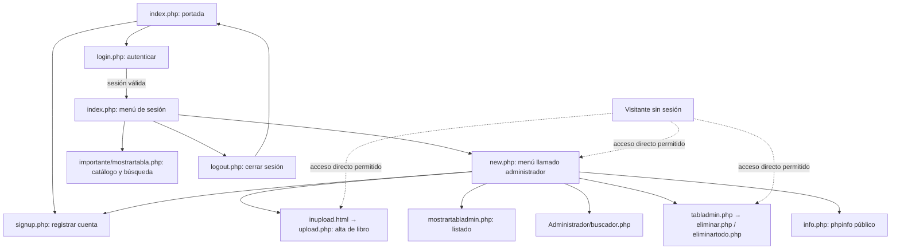
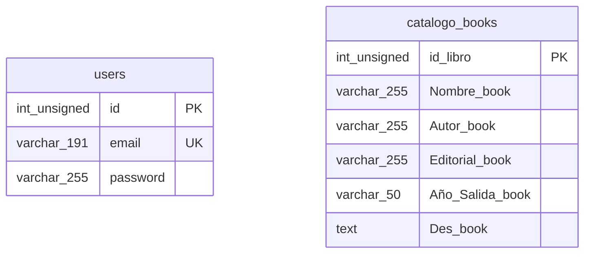

# Auditoría y arqueología de Andrew's Bibliotecary

Fecha de inspección: **20 de noviembre de 2026**. Alcance: fuentes del repositorio local, cambios de restauración presentes en el árbol de trabajo y servicio local `http://localhost:8080`. Este documento describe el sistema observado antes de la modernización; no atribuye funciones nuevas al legado.

## 1. Procedencia y conservación

El último commit de la aplicación antigua es `372dbf3` (`Andrew's Bibliotecary`), precedido por `c2eca92` y `6012c23`. Al comenzar la misión existían cambios locales sin commit procedentes de la restauración de arranque: conexión configurable, rutas relativas, sentencias preparadas, compatibilidad PHP 8, formularios reparados y Docker. Por tanto, **commit original y versión restaurada no son la misma línea base**.

La inspección no modificó código legado ni escribió o eliminó registros. Se revisaron recursivamente todos los PHP, HTML, CSS, SQL, documentación, configuraciones de arranque y notas del proyecto; de los binarios se registraron ruta, tamaño y SHA-256. No se descargó ni clonó el repositorio. La licencia existente es GNU GPL versión 3 (`LICENSE:1-2`). La rama de modernización y la copia recuperable se gestionan por separado; véase `docs/evidence/legacy-integrity.json`.

Evidencia ejecutable de esta auditoría: `docs/evidence/legacy-baseline.json`. Contiene inventario con hashes, respuestas HTTP resumidas y la salida del análisis sintáctico. No contiene contraseñas, contenido de `phpinfo()` ni filas de usuarios.

## 2. Dominio funcional comprobado

Es un **catálogo bibliográfico con registro e inicio de sesión**. Un libro contiene título, autor, editorial, año de salida textual y descripción. Hay pantallas denominadas «administrador» y «usuario», pero no son roles de autorización: el nombre del directorio o del enlace no limita acceso.

No existen tablas, rutas ni lógica para préstamos, devoluciones, lectores prestatarios, ejemplares, reservas, multas, disponibilidad por ejemplar, categorías, ISBN, subida de portadas, edición de libros, historial o recuperación de cuentas. Tampoco se encontró una API o un frontend JavaScript ejecutable. No deben presentarse esas funciones como capacidades heredadas.

### Flujo real

`index.php:5-15` consulta al usuario de la sesión y `index.php:29-40` cambia los enlaces visibles. No protege las páginas de destino. `new.php:1-19` no ejecuta comprobaciones de sesión. El enlace «Entrar a modo Administrador» del catálogo apunta a `../logout.php` (`importante/mostrartabla.php:86`): cierra la sesión, no eleva privilegios.

## 3. Inventario de rutas, formularios y módulos

| Ruta o recurso | Entrada / responsabilidad | Evidencia |
| --- | --- | --- |
| `/`, `/index.php` | GET: portada o menú según sesión; consulta usuario por ID | `index.php:2-16`, `29-55` |
| `/signup.php` | GET formulario; POST `email`, `password`; hash bcrypt e INSERT de cuenta | `signup.php:6-20`, `46-50` |
| `/login.php` | GET formulario; POST `email`, `password`; SELECT por correo, verificación, regeneración de sesión y redirección | `login.php:7-22`, `48-52` |
| `/logout.php` | GET: limpia y destruye sesión; redirige a inicio | `logout.php:2-9` |
| `/new.php` | GET: enlaces de consulta, alta, registro, borrado, búsqueda e información técnica | `new.php:10-17` |
| `/importante/inupload.html` | GET: formulario bibliográfico; POST a `upload.php`; campos `nombre`, `autor`, `editor`, `añopub`, `desc`, submit `PABLO` | `importante/inupload.html:13-23` |
| `/importante/upload.php` | POST con `PABLO`: inserta libro; GET sin acción: «no se subio» | `importante/upload.php:4-11`, `27-29`, `40-41` |
| `/importante/mostrartabla.php` | GET: tabla completa; GET `envio` + `busqueda`: segunda tabla de coincidencias por título | `importante/mostrartabla.php:18-20`, `35-51`, `68-83` |
| `/importante/mostrartabladmin.php` | GET: listado bibliográfico sin ID, sin filtros | `importante/mostrartabladmin.php:20-48` |
| `/Administrador/buscador.php` | GET `envio` + `busqueda`: búsqueda parcial por título; título HTML erróneo «Buscar Usuario» | `Administrador/buscador.php:9`, `17-19`, `33-49` |
| `/Administrador/tabladmin.php` | GET: lista con IDs; dos formularios POST para borrado individual o total | `Administrador/tabladmin.php:15-18`, `34-49`, `53-55` |
| `/Administrador/eliminar.php` | POST `del`, `ide`: DELETE por ID; mensaje de éxito aunque no encuentre registro | `Administrador/eliminar.php:4-10` |
| `/Administrador/eliminartodo.php` | POST `delall`: DELETE de todo el catálogo, sin filtro ni confirmación | `Administrador/eliminartodo.php:4`, `18-19` |
| `/info.php` | GET: diagnóstico completo de PHP, públicamente accesible | `info.php:1` |
| `/database.php` | Conexión PDO configurable; error público resumido y log interno | `database.php:2-17` |
| `/Administrador/database.php`, `/importante/database.php` | Adaptadores que incluyen la conexión raíz | ambos archivos, líneas `1-2` |
| `/parciales/header.php` | Enlace relativo al inicio según directorio del script | `parciales/header.php:1-3` |
| `/parciales/header2.php` | Variante de cabecera hacia `new.php`; sin referencias encontradas | `parciales/header2.php:1-3` y búsqueda recursiva |

Los formularios de alta y borrado declaran `multipart/form-data`, pero **no hay campos `type=file`, uso de `$_FILES` ni procesamiento de archivos**. «upload» significa insertar metadatos del libro; no implica una capacidad de carga de documentos.

### Presentación y recursos

| Archivo | Uso y observación |
| --- | --- |
| `interfaz/css/style.css` | Portada y autenticación; estilos globales y tarjeta de acceso. `font-size:16` sin unidad (`:4`), `outline:none` (`:59`), anchos fijos de inputs (`:62`, `:72`) y posicionamiento absoluto del avatar (`:50-55`). |
| `interfaz/css/tabladmin.css` | Menú, catálogos y administración; contenedor fijo de 600px (`:23-26`), tabla al 100% (`:28-33`), estados hover. |
| `interfaz/css/formulario.css` | Alta de libro; formulario absoluto centrado con `max-width:25%` (`:19-31`), blur y eliminación del foco (`:58`). |
| `interfaz/css/catlogo.css` | Hoja de estilo sin referencias en las páginas actuales. Duplica reglas globales de cabecera, enlaces e inputs. |
| `Andrews.jpg`, `interfaz/css/CX.png` | Imagen de portada y avatar de autenticación. PNG aproximado de 1,48 MB; sin variantes adaptables ni lazy loading. |
| `others/consejos y codigos cortados.txt` | Notas y fragmentos no ejecutados: menciones a jQuery, vídeo y estilos incompletos. No prueban dependencias o funciones activas. |

Las páginas cargan Lora/Smooch desde Google Fonts (`index.php:24`, `login.php:31`, entre otras). No hay paquete local de fuentes. La inspección local no necesitó consultar esos servicios.

## 4. Persistencia, SQL y relaciones

La conexión usa PDO MySQL con parámetros y `charset=utf8mb4` (`database.php:9-13`). El esquema del árbol de trabajo está en `database/schema.sql`; no existe en el commit original. Las tablas se verificaron mediante `SHOW TABLES` y `SHOW COLUMNS`, sin leer filas ni hashes de contraseña.

**No hay relaciones entre las dos tablas**, claves foráneas, timestamps, dueño del registro o columna de rol. Ambas usan InnoDB y colación `utf8mb4_unicode_ci`. Todas las columnas de negocio son `NOT NULL`; la descripción «opcional» del formulario se representa mediante cadena vacía, no `NULL`. El año es texto de hasta 50 caracteres: el formulario incluso indica escribir «X» si falta un dato (`importante/inupload.html:15`). La migración debe conservar esos valores sin convertirlos silenciosamente en enteros o años válidos.

| Operación SQL actual | Estado y limitaciones |
| --- | --- |
| Usuario de sesión por ID | Preparada, `index.php:6-9`; selecciona también el hash aunque la vista solo necesita correo. |
| Usuario por email | Preparada, `login.php:8-11`; no hay normalización/validación de correo ni rate limit. |
| Alta de usuario | Preparada, bcrypt, `signup.php:7-14`; unicidad de correo respaldada por el esquema restaurado. |
| Alta de libro | Preparada, `importante/upload.php:27-28`; sin validación de campos o límites previos. |
| Búsqueda por título | Preparada, `%texto%`, `Administrador/buscador.php:34-37` y `importante/mostrartabla.php:36-39`; no hay búsqueda de autor, filtros o paginación. `%` y `_` conservan semántica comodín. |
| Listados | `SELECT *` sin orden ni límite, tres copias; volumen de respuesta crece con la tabla. |
| Borrado individual | Preparada, `Administrador/eliminar.php:8-9`; no valida ID ni cuenta filas afectadas. |
| Borrado total | SQL fijo, `Administrador/eliminartodo.php:18`; no es inyección por entrada, pero es una operación destructiva sin autorización. |

No existen `UPDATE`, `JOIN`, transacciones de negocio, repositorios, ORM, migraciones versionadas o mecanismos de rollback. El archivo SQL no declara `SET NAMES` en el árbol inspeccionado; aunque la tabla local tiene la columna `Año_Salida_book` correctamente codificada, una futura importación depende de la codificación del cliente. Debe probarse expresamente el camino de importación.

## 5. Dependencias y operación

La versión restaurada añade `Dockerfile:1-6` (PHP 8.4 Apache y extensión `pdo_mysql`) y `compose.yaml` (web local en 8080, MySQL 8.4, healthcheck y volumen persistente). No hay Composer, npm, manifiestos de dependencias, lockfiles, CI, herramientas de análisis estático o suite de pruebas en el legado. No se identificó una librería JS activa; la referencia a jQuery aparece solo en notas.

Versiones efectivamente observadas en el contenedor: **PHP 8.4.28** y **MySQL 8.4.13**. Las etiquetas de imágenes no fijan digest en los archivos de arranque. La red de Compose mantiene MySQL sin puerto publicado y el servidor web se publica en loopback. Estos controles de despliegue local no sustituyen autorización a nivel de aplicación.

## 6. Diferencias entre original Git y restauración previa

La comparación se hizo con `git show HEAD:<archivo>` y `git diff` al iniciar la auditoría:

| Original `372dbf3` | Árbol restaurado recibido |
| --- | --- |
| Tres copias de conexión con parámetros fijos | Conexión raíz configurable por entorno y dos adaptadores |
| Redirecciones a `/Andrews_bibliotecary_CX` | Rutas relativas a `index.php` |
| INSERT de libro, búsqueda y borrado individual concatenaban entradas | Consultas preparadas en esos caminos |
| Sin esquema de creación ni Docker | SQL inicial y entorno Docker local |
| `count(false)` potencial en sesión de usuario ausente | Comprobación explícita de resultado en `index.php` |
| Imagen `andrews.jpg` con diferencia de mayúscula, etiquetas `img` incompletas | Referencia `Andrews.jpg` y etiquetas reparadas |
| Sin regeneración explícita al autenticar | `session_regenerate_id(true)` |
| Duplicado de correo podía terminar en excepción sin manejo | Mensaje de duplicado para SQLSTATE `23000` |

No se deben registrar las consultas concatenadas originales como vulnerabilidad todavía presente en la restauración. Sí forman parte de la historia y deben tener pruebas de regresión en la aplicación nueva.

## 7. Línea base ejecutada

Se ejecutaron comprobaciones exclusivamente locales, sin modificar las tablas:

| Comprobación | Resultado observado |
| --- | --- |
| `php -l` mediante el contenedor web | **18/18 archivos PHP** sin errores sintácticos, salida 0. |
| GET sin sesión a 18 rutas/recursos | **18 respuestas HTTP 200**; 16 rutas de texto sin indicadores de error PHP. Las dos imágenes se verificaron por estado y tamaño, no se interpretaron como PHP. |
| GET `/new.php`, `/Administrador/tabladmin.php`, `/Administrador/buscador.php` sin sesión | HTTP 200: confirma exposición de interfaces administrativas; no se ejecutaron sus POST destructivos. |
| GET `/info.php` | HTTP 200 y marcador `PHP Version`; contenido sensible no almacenado. |
| POST login con identidad ficticia inexistente | HTTP 200 y mensaje de credenciales rechazadas; no error PHP. |
| `SHOW TABLES`, `SHOW COLUMNS` | Dos tablas, columnas y tipos acordes al esquema restaurado; año local correctamente codificado. |
| Suite de pruebas automatizadas preexistente | **No existe**; no hay runner que ejecutar. El lint no equivale a pruebas funcionales o de seguridad. |

Los tiempos de `Invoke-WebRequest` de la evidencia incluyen el cliente PowerShell y su resolución de conexión; **no son métricas de rendimiento del navegador ni de 60 FPS**. Un control adicional con `curl.exe` obtuvo HTTP 200 en las rutas principales.

El alta/borrado de libros y registro de cuentas se identificaron por inspección de código; **no se reejecutaron como escrituras durante esta auditoría basal** para conservar la base existente. Tampoco se probó borrar todo. La futura suite debe validar estas operaciones sobre una base desechable y datos ficticios; un GET 200 a un endpoint de acción no demuestra que su POST sea correcto.

## 8. Deuda técnica y funcional

1. **Sin límites arquitectónicos.** Cada PHP mezcla acceso a datos, manejo de entrada, decisión de negocio y HTML (`importante/upload.php:1-43`, `Administrador/buscador.php:1-55`). No hay router, controladores o capa de autorización central.
2. **Duplicación.** Tres tablas bibliográficas repiten consultas y rendering de las mismas cinco columnas; dos búsquedas casi idénticas; cuatro CSS repiten reglas globales. Los adaptadores DB ya están centralizados por la restauración, pero el original contenía tres conexiones independientes.
3. **Privilegios solo visuales.** La sesión afecta la portada, no los módulos; el menú llamado administrador es público. El borrado total carece de confirmación o posibilidad de recuperar registros. Ver auditoría de seguridad para clasificación e impacto.
4. **Entrada sin contrato.** Formularios basados en placeholders, sin labels, `required`, límites útiles o validación del servidor. La descripción opcional y el año textual deben conservar su semántica, pero comunicarse mejor.
5. **Salida HTML sin escape.** Los campos de libros se imprimen directamente (`importante/mostrartabla.php:44-48`, `75-79`, y tablas equivalentes). La restauración solo escapa el correo de bienvenida.
6. **Operaciones sin feedback preciso.** El borrado afirma éxito sin revisar filas; no hay redirect-after-post, errores por campo, estados vacíos o loading. No hay recuperación de contraseña.
7. **Escalabilidad limitada.** Tablas completas sin paginación, búsqueda por `%texto%` sin índice de búsqueda, `SELECT *` y duplicación de tabla completa más resultados en una misma página.
8. **HTML y accesibilidad.** `lang="en"` en contenido español, ausencia de meta viewport, inputs sin nombre accesible y foco removido, celdas de encabezado `<td>` en lugar de `<th>`, anidamientos/formularios mal cerrados (`importante/mostrartabla.php:18-32`, `mostrartabladmin.php:18-30`).
9. **Experiencia móvil.** Anchos fijos, formulario absoluto y espaciado con múltiples ` `; no hay breakpoints ni sistema de tokens/componentes. Ningún resultado de conformidad WCAG se infiere de la inspección.
10. **Diagnóstico expuesto y operación manual.** `phpinfo()` público, sin gestión profesional de errores, auditoría de eventos, backups automatizados o migraciones reversibles. Las claves locales de ejemplo no son configuración de producción.
11. **Archivos huérfanos.** `header2.php` y `catlogo.css` sin referencias; notas personales no ejecutables. Se conservarán como legado, sin trasladarlas como requisitos funcionales.

## 9. Contrato de conservación para 2.0

| Comportamiento legado legítimo | Condición de aceptación en 2.0 |
| --- | --- |
| Registrar cuenta e iniciar/cerrar sesión | Autenticación validada, sesiones protegidas y cierre mediante POST con CSRF. |
| Consultar catálogo sin sesión | Catálogo público de solo lectura, con paginación, filtros y estados vacíos. |
| Buscar por título | Conservar coincidencia de títulos y añadir búsqueda eficiente/validada, sin SQL concatenado. |
| Alta de libro con cinco metadatos | Mismos valores semánticos; preservar años textuales y descripciones vacías del origen. |
| Gestión desde menú administrativo | Roles y políticas reales; no trasladar el acceso anónimo como comportamiento legítimo. |
| Eliminar un libro por ID | Acción autorizada con confirmación y opción de recuperación; proteger IDs por política. |
| Eliminar todo el catálogo | Mantener el caso de gestión de lote de forma controlada y reversible, documentando el cambio respecto del DELETE irreversible antiguo. |
| Registrar usuarios desde administración | Flujo explícito autorizado sin permitir elegir privilegios en registro público. |
| Información técnica del servidor | Sustituir la divulgación pública por diagnóstico mínimo protegido; documentar la retirada del `phpinfo()` público. |

Edición de metadatos, historial administrativo y estadísticas del catálogo son posibles mejoras nuevas compatibles con el dominio, no funcionalidades recuperadas. Préstamos y gestión de ejemplares quedan fuera del alcance heredado mientras no se acuerde un nuevo dominio.
