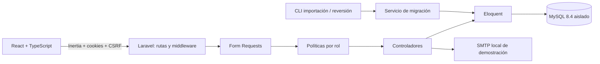
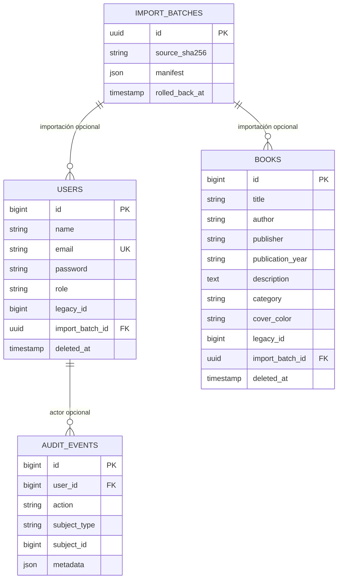

# Arquitectura de Andrew's Bibliotecary 2.0

## Decisiones

Monolito modular Laravel 13/PHP 8.4: rutas y middleware, Form Requests, políticas,
controladores pequeños y Eloquent. React 19 + TypeScript con Inertia 3 entrega una
experiencia SPA conservando sesiones y autorización de Laravel. Tailwind CSS 4 y
componentes basados en Radix con el patrón shadcn/ui constituyen el sistema visual.
MySQL 8.4 es la persistencia local; PHPUnit usa SQLite en memoria y el perfil E2E
usa un archivo SQLite privado separado, sin compartir la base principal.

Las dependencias PHP residen en el volumen Docker `modern_vendor`, montado en
`/var/www/html/vendor` y compartido por `app` y `app-e2e`; evita la latencia de
lecturas del bind mount de Windows. Un `vendor/` del host no es el directorio
efectivo del runtime. El instalador ejecuta Composer sobre ese volumen. El
entrypoint de Docker prepara en cada arranque los permisos de `www-data` solo
en `modern/storage` y `modern/bootstrap/cache`, sin operar sobre el legado.

Vite se invoca con `--config vite.config.ts`, independiente del archivo JavaScript
del scaffold. Boost es una dependencia de desarrollo habilitada únicamente bajo
`PHP_SAPI === 'cli'`, con `browser_logs_watcher=false`; sus ayudas no se exponen
como rutas ni scripts web.

No se incorpora una API pública ni JWT: ambas aumentarían la superficie de
ataque sin aportar valor al flujo web comprobado. No se añaden tablas de préstamos
ni un falso estado de disponibilidad física. “Activo” significa registro visible
en el catálogo, no libro disponible para préstamo.

## Modelo de datos

Tablas de infraestructura: sesiones, tokens de recuperación, caché y trabajos,
según Laravel. Se omiten contraseñas/tokens/correos completos en eventos de
auditoría. Índices: email único, role, title, author, publisher, category,
publication_year, deleted_at e import_batch_id. El año permanece texto para
conservar valores históricos como “X” o rangos. Las categorías son metadatos
editoriales nuevos; los registros importados usan “General”.

## Permisos y flujos

| Acción | Visitante | Lector | Bibliotecario | Admin |
| --- | --- | --- | --- | --- |
| Consultar/buscar catálogo y detalles | Sí | Sí | Sí | Sí |
| Registro, acceso y recuperación | Sí | — | — | — |
| Perfil y contraseña propios | — | Sí | Sí | Sí |
| Panel de resumen | — | Sí | Sí | Sí |
| Alta/edición/archivado/restauración de libros | — | — | Sí | Sí |
| Cuentas de trabajo y cambio de rol | — | — | — | Sí |
| Archivar catálogo completo | — | — | — | Sí, con contraseña y confirmación |
| Historial de acciones | — | — | — | Sí |

Un lector se registra y consulta; un bibliotecario mantiene las fichas y puede
recuperarlas de la papelera; un administrador gestiona además las cuentas y
revisa el historial. Los permisos se validan en cada ruta y política; ocultar un
botón solo mejora la interfaz. El registro nunca permite elevar privilegios.

## Seguridad y límites de operación

Sesión regenerada al autenticar, invalidada al salir; cookies HttpOnly y SameSite
Lax. Secure se activa bajo HTTPS; HTTP se limita a loopback para desarrollo.
CSRF, throttling, hashing Laravel, validación central, Eloquent parametrizado,
React escapando texto, CSP y cabeceras defensivas. Solo `public/` se sirve por
Apache. La base no expone puerto al host. No se ofrecen uploads de archivos ni
URLs arbitrarias de portada; las cubiertas se generan localmente.

La generación de enlaces usa `APP_URL` como raíz canónica. TrustHosts acepta el
hostname exacto configurado, sin subdominios automáticos, en producción; Laravel
omite esa restricción en entorno local y unit tests. La raíz canónica sigue
protegiendo los enlaces locales. El cambio de contraseña usa `regenerate(true)`
y revoca las otras sesiones persistidas. La revisión independiente y las tres
regresiones de URLs están en [backend-review.json](evidence/backend-review.json);
el recorrido completo de navegador se valida por separado.

Para la convivencia, el Compose raíz añade máscaras sobre los directorios nuevos
y Git mediante `compose.override.yaml`, sin alterar los scripts antiguos. La
aplicación nueva usa `localhost:8081`, E2E `localhost:8082` con cookie distinta y
el legado `127.0.0.1:8080`. La identidad de host separada evita compartir cookies
con el PHP antiguo; la configuración Apache nueva redirige las solicitudes a
`localhost:8080` antes de PHP y rechaza otros hosts. Se verificaron HTTP 302 hacia
`http://127.0.0.1:8080/`, HTTP 200 en ese destino y 404 para los tres archivos
privados comprobados en [legacy-host-isolation.json](evidence/legacy-host-isolation.json).
La búsqueda usa `LIKE` parametrizado con comodines escapados y paginación; no se ha incorporado
un índice full text ni demostrado un volumen de 50.000 registros.

La [medición local](evidence/browser-performance.json) registra los tiempos de
carga, ausencia de carga inicial de Three.js y WebGL activo tras el opt-in. El
[informe final](08_PRUEBAS_RENDIMIENTO_Y_ACCESIBILIDAD.md) recoge las cifras y el
entorno; la cadencia rAF no certifica FPS de GPU ni rendimiento universal.
Recuperación de correo en producción, HTTPS, backups operativos y monitorización requerirán
configuración explícita antes de cualquier publicación futura.
