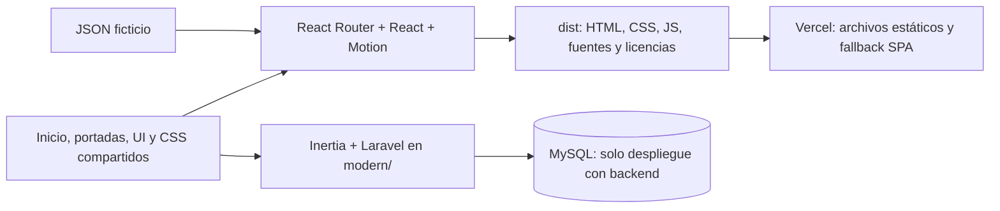

# Demo independiente y publicación en Vercel

## Arquitectura

La presentación compartida permanece en `modern/resources`: no se duplica la hoja de estilos, el inicio editorial, las portadas, el libro físico ni los controles Radix. `PresentationNavigation` recibe el transporte: Inertia en Laravel y React Router en la demo. Los shells difieren porque la demo no tiene sesión, permisos ni operaciones de servidor.

La raíz npm compila `demo/vite.config.ts` y escribe `dist/`. No ejecuta Composer, Artisan ni MySQL. `modern/package.json` conserva su instalación separada; `resolve.dedupe` evita dos React en la demo cuando ambas instalaciones existen. El JSON deriva de la colección ficticia de `DemoSeeder`; no se exportaron usuarios, contraseñas ni la base existente. El taller usa un contexto React en memoria y escape normal de texto, sin solicitudes HTTP de negocio.

## Movimiento y accesibilidad

Tokens en `modern/resources/css/motion.css`: 140 ms en controles, 240 ms en entradas y 420 ms en transiciones; curva `(0.22,1,0.36,1)`. La portada permanece visible sin botón ni animación de apertura. No se fabrican páginas de lectura.

`LazyMotion` con `domMax` habilita las transiciones de posición de las tarjetas. React Router usa View Transitions para compartir `cover-{id}` entre tarjeta y cubierta. Sin API, navega inmediatamente con entrada CSS. `MotionConfig reducedMotion="user"`, la desactivación explícita de layout y CSS respetan la preferencia de movimiento reducido.

La URL conserva búsqueda/categoría/orden/página. La restauración registra scroll antes del cambio de DOM y el enlace seleccionado; restaura foco y posición sin scroll suave. Tabs con flechas/Home/End y roles ARIA; diálogos Radix con foco restaurado, incluido WebKit al abrir desde botones de tabla.

Por petición del usuario se retiró la vista 3D opcional, su botón y las dependencias Three.js. La portada mantiene la composición editorial CSS. La apertura de fichas conserva su animación CSS y no necesita WebGL.

## Ajustes de Vercel

| Ajuste | Valor |
|---|---|
| Root Directory | Raíz del repositorio; dejar vacío |
| Framework | Vite |
| Node | 24.x recomendado; mínimo 22.12 |
| Install | `npm ci` |
| Build | `npm run build` |
| Output | `dist` |
| Variables de entorno | Ninguna |
| Functions / PHP / MySQL | Ninguno |

`vercel.json` define `/(.*)` → `/index.html` y CSP, nosniff, protección de frames y política de referencias. No activar `cleanUrls` sin adaptar el destino. Inline CSS es necesario para estilos de cubiertas/Motion; no se permite inline JavaScript ni eval. No se desactiva la protección de un proyecto para obtener una URL pública.

`.vercelignore` reduce la carga por CLI, excluyendo configuración privada, runtime y backend PHP, reteniendo recursos compartidos y procedencia legal. El artefacto público es exclusivamente `dist`; la exclusión no sustituye las reglas de Git.

Tras disponer de permisos:

1. Publicar las ramas histórica, de recuperación y release, sin force push; crear PR a `main`, sin fusionarlo.
2. Importar `Yukyshiram/Andrew-Studio` con los ajustes anteriores. No construir el `main` legado: elegir la rama release para el preview y conservar `main` como futura rama de producción.
3. Verificar preview con `/`, `/catalog?q=atlas`, `/catalog/1`, `/studio`, recargas, consola, red y CSP.
4. Autorizar la integración GitHub/Vercel para previews por push del PR. No introducir tokens en el repositorio ni conceder al workflow permisos para publicar.
5. Publicación pública y merge requieren aprobación. Añadir después al README la URL real verificada.

La demo no necesita infraestructura de base de datos ni opciones de pago. Las cuotas/condiciones de la cuenta deben comprobarse antes de publicar; no se promete coste cero bajo cualquier uso ni se activan mejoras de pago.

## Estado remoto comprobado

Vercel permite consultar la cuenta y su equipo. Crear `andrews-bibliotecary` devolvió **403 forbidden**, sin permiso de creación. No se creó proyecto ni deployment. La CLI carece de credenciales propias; el flujo de login que inició su consulta se canceló sin autenticar. No se repitió la mutación ni se modificaron permisos para sortearla. No se afirma que volver a iniciar sesión solucione esta denegación.

GitHub no tiene conexión disponible ni credencial utilizable en el Git local. No se declara creado un PR remoto ni publicadas las ramas. El cuerpo del PR y release quedan preparados localmente.

## Historial y reversión

`archive/legacy-v1` y `v1-legacy-final`: commit histórico `372dbf39743656ae1f06971b1c6f11c07a655a2c`, con sus vulnerabilidades históricas. `codex/bibliotecary-2`: checkpoint `6752641` con restauración previa, Laravel y evidencia. Esta referencia de recuperación se mantiene sin nuevos cambios.

La limpieza del legado se hace en un worktree de release separado. El checkout de trabajo conserva originales; no se borran bases, respaldos ni volúmenes. LICENSE, auditorías, migraciones y Laravel permanecen. Antes del merge basta cerrar el PR para no cambiar `main`. Tras un merge autorizado, revertir mediante nuevo commit y elegir el deployment anterior en Vercel; no hacer reset remoto ni force push. La demo no tiene datos que migrar. El futuro backend sigue [06_MIGRACION.md](06_MIGRACION.md).

## Fuentes

- [Vercel: Vite y rutas SPA](https://vercel.com/docs/frameworks/frontend/vite), [configuración](https://vercel.com/docs/project-configuration/vercel-json).
- [Motion: layout](https://motion.dev/docs/react-layout-animations), [movimiento reducido](https://motion.dev/docs/react-motion-config).
- Actions fijadas por SHA consultado en tags oficiales: [checkout](https://github.com/actions/checkout/releases/tag/v7.0.1), [setup-node](https://github.com/actions/setup-node/releases/tag/v7.1.0), [upload-artifact](https://github.com/actions/upload-artifact/releases/tag/v7.0.0). CI usa `pull_request`, permisos de lectura y bases aisladas; no `pull_request_target` con privilegios.
