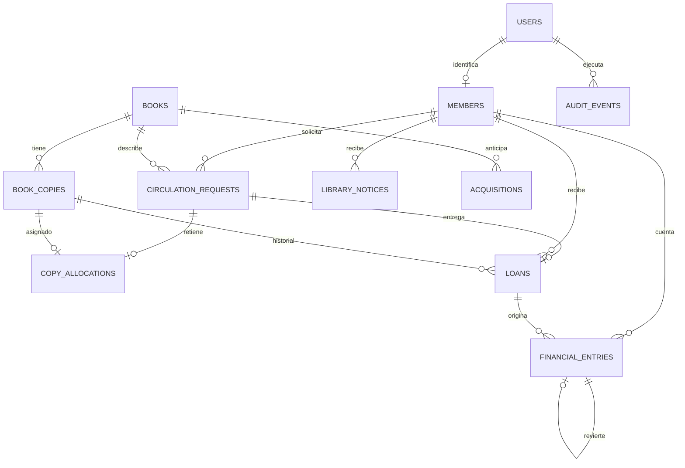

# Andrew's Bibliotecary 3.0 — Dominio y plan de implementación

## Verificación inicial y conservación

Antes de modificar archivos se ejecutaron `git rev-parse --show-toplevel`, `git remote -v` (con ocultación preventiva de credenciales), `git branch --show-current`, `git status --short`, `git branch -avv`, `git show 827be7c` y el grafo de historia. El remoto es exactamente `https://github.com/Yukyshiram/Andrew-Studio.git`; raíz `C:/Users/Im_JVallejo/Documents/GitHub/Andrew-Studio`; árbol limpio en `827be7cb97c8ae2dac0726cf354ba48f0c618c61`. Se crea `codex/bibliotecary-3` desde ese commit.

Referencias que deben permanecer intactas: `main`, `origin/main`, `archive/legacy-v1` y `v1-legacy-final` en `372dbf3`; `codex/bibliotecary-2` en `6752641`; `feature/interactive-demo` en `ea25146`; `release/bibliotecary-v2` en `d81d51e`; `codex/ux-role-clarity-2.6` en `827be7c`. El release contiene la reorganización de directorios; no es ancestro directo de 2.6. Los 34 archivos originales siguen bajo el inventario `docs/evidence/legacy-integrity-final.json`. No se cambia ningún remoto ni se hace push, merge o publicación.

## Investigación y situación existente

En la inspección inicial de 2.6 se revisaron modelos, migraciones, servicios, políticas, controladores, rutas, tipos React y pruebas. En ese punto `books` describía títulos y `users` identificaba cuentas con roles reader/librarian/admin; no existían ejemplares, préstamos, socios bibliotecarios, reservas ni contabilidad. La demo permitía editar fichas únicamente en memoria. No se atribuyen funciones de circulación a la versión anterior. El avance real de A–C está en [Implementación](17_IMPLEMENTACION_3.md), y las reglas ejecutadas de reservas en [Etapa C](18_RESERVAS_Y_RENOVACIONES.md); tesorería, novedades y circulación estática siguen pendientes.

Referencias primarias consultadas el 21/11/2026:

- [IFLA LRM: entidades y propósito](https://iflastandards.github.io/platform/LRM/docs/intro/): distingue manifestación bibliográfica y ejemplar individual. Aquí `books` representa una descripción de edición y `book_copies` un ejemplar. Es una adaptación práctica; no se anuncia conformidad MARC ni una implementación completa de Work/Expression/Manifestation/Item.
- [Koha: circulación](https://koha-community.org/manual/latest/en/html/circulation.html): separa reserva, preparación para recogida, entrega, devolución y renovación; contempla reglas y caducidad. Se adoptan estas distinciones, con decisiones propias documentadas abajo.
- [Koha: políticas de circulación](https://koha-community.org/manual/latest/en/html/circulationpreferences.html): bloqueos por vencimientos, renovaciones y registro de responsables. No se copian sus valores predeterminados como reglas oficiales.
- [Laravel 13: migraciones](https://laravel.com/framework/docs/13.x/migrations), [bloqueo pesimista](https://laravel.com/framework/docs/13.x/queries#pessimistic-locking) e [Inertia 3: formularios](https://inertiajs.com/docs/v3/the-basics/forms).

## Requisitos y decisiones

Esencial en esta versión: inventario individual, membresía/contacto mínimo, políticas administrables, solicitud validada por personal, preparación/entrega, préstamos/devoluciones, reservas FIFO, caducidad de recogida, renovación condicionada, calendario, cargos reproducibles, libro de movimientos inmutable con reversión, pagos manuales, informes por periodo, adquisiciones/novedades, privacidad y demo completa sin backend.

Fuera de esta fase: pasarelas/cobros reales, préstamos entre sucursales, MARC/autoridades, RFID, compra a proveedores y contabilidad fiscal. No se añaden módulos vacíos ni enlaces hacia estas posibilidades.

### Identidad y permisos

Visitante: catálogo, disponibilidad agregada y novedades. Lector: sus solicitudes, reservas, préstamos, avisos y saldo. Bibliotecario: socios, inventario y circulación; no modifica roles, políticas ni tesorería. Administrador: además políticas, roles y finanzas. Los roles existentes se conservan y se comprueban en servidor. La selección de perfiles de la demo no es autenticación.

`members` enlaza una sola cuenta y un número de socio único. Nombre/correo permanecen en `users`; solo se añade teléfono opcional, estado, vencimiento y límite individual opcional. No se solicitan documentos oficiales ni domicilios. La baja de una cuenta o ficha no borra su historial. Las cuentas antiguas requieren alta explícita de socio; una cuenta registrada nueva recibe membresía activa dentro de su transacción. La migración no interpreta automáticamente cuentas antiguas como socios autorizados.

### Ejemplares y catálogo

ISBN opcional (10/13, normalizado y validado), edición e idioma se añaden sin reemplazar campos previos. Un título puede tener cero o varios ejemplares: cero significa «Sin ejemplares incorporados», nunca disponibilidad inventada. Cada ejemplar tiene código de barras único, ubicación, condición y estado. No se puede retirar o alterar a disponible un ejemplar asignado. Archivar una ficha debe bloquearse si existen operaciones abiertas.

### Circulación y espera

Solicitud pendiente → validación por bibliotecario → preparada (ejemplar retenido y plazo de recogida) → entrega confirmada → préstamo activo → devolución/cierre. Sin ejemplar, la solicitud aprobada queda en espera. Rechazo/cancelación/caducidad son cierres distintos con motivo y fecha. Un usuario solo puede mantener una solicitud abierta por título y no puede pedir un título que ya tenga prestado. La prioridad inicial es igual para todos; el orden es fecha e identificador, sin atajos editables por lectores.

La asignación se hace a la primera reserva elegible; una suspendida/vencida se cierra con aviso. Cancelar, devolver o expirar libera el ejemplar y atiende la siguiente. No se considera entregado un libro por solicitarlo o por estar preparado. La entrega revalida membresía, cupo, deuda y vencimientos.

La transacción toma primero el bloqueo de la política única, después filas del dominio. Esto serializa mutaciones de circulación para una biblioteca pequeña y evita ordenamientos incompatibles de bloqueos. Se complementa con índices únicos de solicitud abierta y asignación de ejemplar. Se documentará la prueba real MySQL; SQLite no demuestra concurrencia InnoDB.

### Fechas y dinero

Instantes se guardan en UTC; fechas límite son días de la zona horaria configurada. Duración en días naturales y desplazamiento al siguiente día abierto. Recogida igual; se prohíbe un calendario sin días abiertos. Retraso: días abiertos posteriores al vencimiento menos gracia, nunca negativo. El reloj de Laravel es controlable en pruebas. Se guarda una instantánea de condiciones en cada préstamo: una edición de tarifas no reescribe acuerdos existentes.

Reglas configurables: zona, moneda, cupo, días de préstamo/recogida, renovaciones, gracia, cierres semanales/específicos, bloqueo de vencidos/saldo, cargos diarios/pérdida/daño. Predeterminados seguros: cargos cero; los parámetros de la demostración son ficticios, no tarifas de una institución.

Todos los importes son centavos enteros. Cargos positivos; pagos/abonos negativos; ajuste firmado; reversión por valor opuesto ligada al movimiento original y solo una vez. No se permite pagar más que el saldo ni revertir creando una situación no válida sin revisión. Motivo, referencia, responsable y fecha siempre se conservan. Las multas diarias usan una clave única por préstamo y fecha; reejecutar no duplica. Los reportes distinguen cargos, pagos, ajustes y reversiones; no confunden saldo con recaudación. No hay pasarela ni cobro real.

### Novedades

Fecha de publicación editorial, llegada estimada e incorporación efectiva son campos distintos. Estados: anunciada, solicitada, en tránsito, incorporada o cancelada. Una llegada estimada nunca crea ejemplares automáticamente; el inventario se registra explícitamente. Filtros por categoría/fecha. Datos de demo identificados como ficticios.

## Modelo previsto

`library_policies` contiene una configuración versionada, sin constantes de tarifas en el frontend. Las FK del dominio restringen eliminación de historia. Los campos y tablas se introducen mediante migraciones aditivas; no se reinterpretan títulos como ejemplares.

## Etapas y puertas de aceptación

| Etapa | Unidad | Puerta antes de avanzar |
|---|---|---|
| A | Bibliografía, ejemplares, socios, políticas/calendario | Migración reversible en base aislada; validación, roles, calendario y conservación comprobados |
| B | Solicitudes, preparación, entrega y devolución | Ciclo funcional, rechazo/cancelación, cupos y unicidad de ejemplar; pruebas HTTP y servicio |
| C | Espera, renovaciones, vencimiento y avisos | FIFO, expiración, restricciones y reloj controlado; idempotencia |
| D | Multas, pagos, ajustes, reversión e informes | Centavos exactos, cálculo reproducible, permisos, auditoría e historial inmutable |
| E | Novedades, gestión y paneles | Operaciones implementadas, filtros y métricas calculadas desde la BD |
| F | Demo, integración visual y validación integral | Ciclo lector/personal sin backend; E2E, accesibilidad, responsive, regresión, capturas y guías |

Cada unidad coherente recibe un commit breve después de sus pruebas. Este documento es un diseño, no evidencia de implementación. El informe final distinguirá ejecutado, pendiente y limitaciones; no se declara terminada una etapa por disponer de una pantalla.
