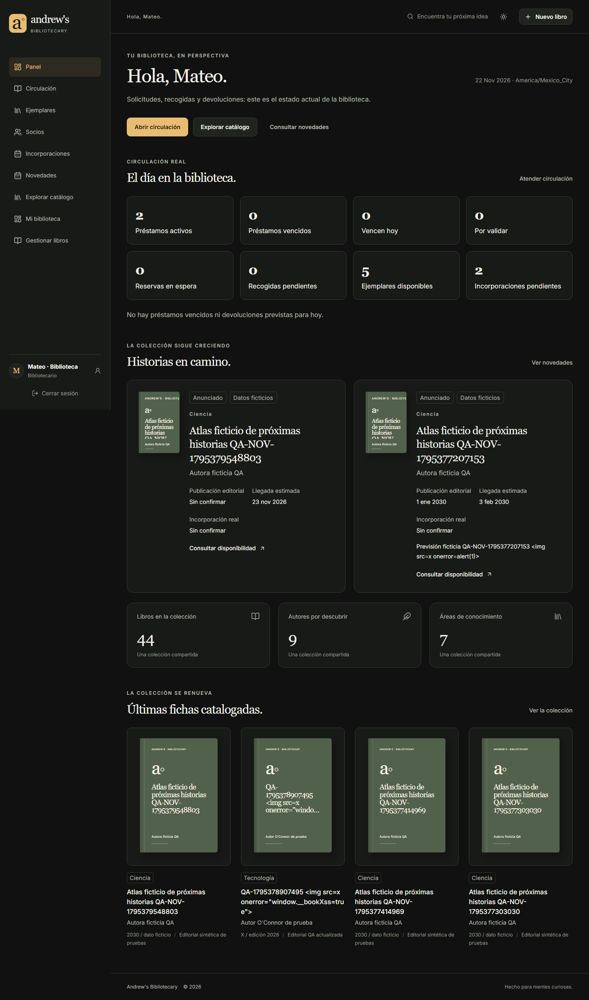

# Andrew's Bibliotecary 3.0 — Laravel

Sistema bibliotecario en español con consulta pública, cuentas y permisos reales. Conserva la catalogación original y añade ISBN/edición/idioma, socios, ejemplares, políticas, solicitudes, preparación y entrega, préstamos, devoluciones, renovaciones, reservas, avisos internos, tesorería e incorporaciones. Sus paneles consultan la base de datos; no muestran cifras de demostración insertadas en el frontend. La demo estática independiente vive en `../demo/`.

La aplicación está en `modern/`. El PHP original se conserva en la raíz y usa otra base de datos. La instalación nueva no importa datos históricos ni publica servicios fuera de loopback.



## Instalación local en Windows

Requisitos: Docker Desktop iniciado con contenedores Linux y Docker Compose, Node.js 24 y npm. El entorno inspeccionado usa Node 24.1.0 y npm 11.18.0. PHP y Composer se ejecutan dentro de Docker; no se requieren instalaciones globales de esas herramientas ni Python.

Desde la raíz del repositorio, en PowerShell:

```powershell
.\modern\scripts\install.ps1 -Demo
```

El script crea `modern/.env` si no existe, genera contraseñas aleatorias para el MySQL nuevo, instala dependencias desde los lockfiles, compila recursos, genera `APP_KEY` si está vacía, inicia servicios y aplica migraciones. En una base nueva destinada a pruebas, `-Demo` llama al `LibraryDemoSeeder` protegido: 25 fichas, seis cuentas, cuatro socios, seis ejemplares y ejemplos coherentes de préstamos, reservas, cargos e incorporaciones. Solo admite entorno local/testing y `DEMO_SEED_ENABLED=true`; rechaza datos reales o una base ya utilizada. Un marcador impide reiniciar la muestra al repetirlo. Para una base nueva vacía, omite `-Demo`. La configuración existente se conserva.

Se verificó instalación limpia y repetición de `install.ps1 -Demo` en un proyecto Docker distinto, con dependencias y volúmenes nuevos, puertos propios y datos exclusivamente ficticios. La repetición conservó el archivo de entorno y la firma del contenido de todas las tablas. También se ensayó un dump y su restauración en otra base del mismo servidor aislado. No se restauró ningún respaldo real ni se borraron volúmenes existentes. La comprobación utilizó el mismo Windows y motor Docker, no otra máquina física; véase el [informe 3.0](../docs/22_RESULTADOS_Y_LIMITES_3.md).

Para una instalación existente, actualiza con respaldo y sin seeding:

```powershell
cd modern
node scripts/upgrade-local.mjs
```

El script crea un respaldo privado, compara las columnas históricas de cuatro tablas y ejecuta migraciones aditivas; no importa ni reinicia datos. No uses `-Demo` para convertir la base conservada en una demostración. [Migración y reversión](../docs/06_MIGRACION.md).

Composer instala en el volumen Docker `modern_vendor`, compartido por `app` y `app-e2e`, para evitar la latencia del montaje de Windows. Ese volumen es la fuente de dependencias PHP del runtime; un `vendor/` existente en el host no lo reemplaza. El entrypoint prepara en cada arranque los directorios `storage/` y `bootstrap/cache/` de la aplicación nueva con permisos de escritura para `www-data`.

| Servicio | Dirección local | Persistencia / alcance |
| --- | --- | --- |
| Laravel 3.0 | [localhost:8081](http://localhost:8081) | MySQL 8.4 independiente, volumen `modern_database` del proyecto Compose |
| Buzón Mailpit | [localhost:8026](http://localhost:8026) | Correo de recuperación capturado localmente; sin entrega externa |
| Aplicación E2E | [localhost:8082](http://localhost:8082) | Solo perfil `qa`; SQLite privado separado |
| Legado | [127.0.0.1:8080](http://127.0.0.1:8080) | Proyecto y volumen originales; host distinto del moderno |

Para iniciar el legado desde la raíz, conserva la carga automática del override nuevo:

```powershell
docker compose up -d --build
```

`compose.override.yaml` de la raíz oculta `modern/`, `.local/`, `.git/` y `docs/` al servidor antiguo. Es necesario porque su DocumentRoot abarca la raíz del repositorio. No lo omitas usando únicamente `-f compose.yaml`. El PHP legado conserva riesgos propios y debe permanecer local; consulta la [auditoría](../docs/02_AUDITORIA_SEGURIDAD.md).

La dirección del legado cambia explícitamente a `http://127.0.0.1:8080`, mientras la aplicación moderna usa `http://localhost:8081`. Cambiar solo de puerto no separa cookies: estos hosts distintos evitan compartir las cookies y XSRF con el PHP antiguo. Se verificó HTTP 302 desde `localhost:8080` hacia `http://127.0.0.1:8080/` antes de ejecutar PHP y HTTP 200 en el destino. Las [comprobaciones de archivos privados](../docs/evidence/legacy-host-isolation.json) devolvieron 404. No se modificaron las fuentes originales para introducir este aislamiento.

## Recorrido de demostración

Estas credenciales son públicas y sirven únicamente para la demostración local. El seeder requiere entorno `local` o `testing` y `DEMO_SEED_ENABLED=true`.

| Rol | Correo | Contraseña |
| --- | --- | --- |
| Administrador | `demo.admin@example.test` | `Demo-Admin2026!` |
| Bibliotecario | `demo.biblioteca@example.test` | `Demo-Biblio2026!` |
| Lector | `demo.lector@example.test` | `Demo-Lector2026!` |

1. Abre el catálogo público, busca por título, autor o editorial y combina categoría, autor y orden. Los filtros quedan en la URL y la consulta pagina de 12 en 12.
2. Entra como bibliotecario para crear o editar una ficha, archivarla y restaurarla desde la papelera. El año admite valores históricos como `X`; las portadas son composiciones locales.
3. Entra como administrador para gestionar cuentas y consultar el historial. Archivar todo exige la contraseña actual y la frase exacta `ARCHIVAR CATÁLOGO`; los libros siguen recuperables.
4. Solicita recuperación de contraseña y revisa el mensaje en Mailpit. Este buzón local no acredita entrega a un proveedor externo.

El registro público siempre crea lectores. Las cuentas desactivadas no pueden autenticarse; no existe una pantalla de restauración de cuentas. El perfil y cambio de contraseña requieren la contraseña actual según el tipo de modificación.

## Desarrollo y comprobaciones

Desde `modern/`:

```powershell
docker compose ps
docker compose logs --tail=100 app
npm run dev
```

Para compilar sin el servidor de desarrollo, usa `npm run build`. Los scripts npm seleccionan expresamente `vite.config.ts` con `--config`; el `vite.config.js` del scaffold no se usa para estos comandos. Prettier está instalado como herramienta de desarrollo. Laravel Boost se limita a CLI en `config/boost.php`, con captura de logs de navegador deshabilitada; no agrega sus rutas o scripts al frontend web.

Para aplicar el formato PHP dentro del contenedor, usa rutas explícitas: la imagen no incluye Git y no admite el modo `--dirty` de Pint.

```powershell
docker compose exec -T app vendor/bin/pint --format agent app bootstrap config database routes tests scripts/export-legacy.php
```

Desde la raíz, la comprobación reproducible es:

```powershell
.\modern\scripts\test.ps1
# Comprobaciones sin navegador:
.\modern\scripts\test.ps1 -SkipBrowsers
# Mantener disponible el servidor de QA al terminar:
.\modern\scripts\test.ps1 -KeepTestServer
```

El script ejecuta PHPUnit tanto en SQLite en memoria como en MySQL 8.4 aislado, PHPStan —incluido el seeder protegido—, TypeScript, build y auditorías. MySQL utiliza `compose.test.yaml`, sin puertos publicados y con datos temporales; se detiene en `finally`. `test-mysql.ps1 -KeepDatabase` permite conservarlo expresamente para depurar. `test.ps1 -SkipMySQL` omite esa parte y no equivale a la puerta completa de calidad. Sin `-SkipBrowsers`, prepara `app-e2e` con la semilla pequeña de QA y ejecuta Playwright; `-KeepTestServer` lo conserva para inspección. E2E usa SQLite privado en 8082, con CSRF real y cookie distinta de la aplicación principal. La configuración rechaza bases URL externas o de la aplicación principal; el ensayo de presentación es de lectura sobre 8081. Los informes se guardan en `modern/output/playwright/`. Las pruebas no se ejecutan sobre producción.

La regresión 3.0 verificó 276 pruebas PHP: SQLite, 272 aprobadas y cuatro exclusivas de MySQL omitidas, con 1.869 aserciones; MySQL, 276 aprobadas y 1.929 aserciones. Pasaron PHPStan, TypeScript, build, auditorías y los 23 recorridos Playwright nativos. Las cifras de 96 pruebas/639 aserciones y 16 recorridos corresponden al [registro histórico 2.0](../docs/08_PRUEBAS_RENDIMIENTO_Y_ACCESIBILIDAD.md). Los resultados actuales y su alcance están en el [informe 3.0](../docs/22_RESULTADOS_Y_LIMITES_3.md); no equivalen a certificación de accesibilidad ni preparación automática para producción.

La [medición histórica de rendimiento](../docs/evidence/browser-performance.json) registra LCP, FCP, TTFB, CLS y cadencia rAF en Chromium, Windows y backend caliente. Incluía una escena WebGL opcional, retirada de la versión actual por petición del usuario. Se conservan las portadas y la apertura animada con CSS. Los resultados históricos dependen de ese entorno y no certifican FPS de GPU ni rendimiento móvil. Se conservaron [13 capturas](../docs/screenshots/) de escritorio y móvil revisadas visualmente. Consulta el [informe de pruebas](../docs/08_PRUEBAS_RENDIMIENTO_Y_ACCESIBILIDAD.md) y la [comparación y operación](../docs/09_COMPARACION_Y_OPERACION.md).

## Datos, respaldo y parada

La importación es voluntaria, de solo lectura en origen y transaccional en destino. Conserva bcrypt y años textuales, asigna lectores y registra lotes con SHA-256. Revisa primero `--dry-run`; la reversión rechaza lotes usados o modificados. Consulta el [procedimiento de migración](../docs/06_MIGRACION.md).

Para detener Laravel conservando su volumen:

```powershell
.\modern\scripts\stop.ps1
```

El script conserva los volúmenes de datos y dependencias. El volumen no sustituye una copia recuperable; véanse los [respaldos y recuperación](../docs/09_COMPARACION_Y_OPERACION.md#respaldo-de-la-base-nueva).

## Arquitectura y documentación

Laravel 13/PHP 8.4, React 19 y TypeScript, Inertia 3, Tailwind CSS 4, componentes basados en Radix y el patrón shadcn/ui, Inter local y MySQL 8.4. Sesiones y autorización se resuelven en el servidor. La búsqueda usa `LIKE` parametrizado; no se presenta como motor full text ni como un ensayo de 50.000 registros.

- [Guía de lector y personal](../docs/23_GUIA_DE_USO_3.md), [modelo y reglas 3.0](../docs/16_DOMINIO_BIBLIOTECARIO_3.md) y [avance por etapas](../docs/17_IMPLEMENTACION_3.md).
- [Reservas/renovación](../docs/18_RESERVAS_Y_RENOVACIONES.md), [tesorería](../docs/19_TESORERIA_Y_MOVIMIENTOS.md), [novedades/paneles](../docs/20_NOVEDADES_Y_PANELES.md) y [demo sin backend](../docs/21_DEMO_CIRCULACION.md).

- [Auditoría del legado](../docs/01_AUDITORIA_LEGACY.md) y [seguridad inicial](../docs/02_AUDITORIA_SEGURIDAD.md).
- [Plan técnico](../docs/03_PLAN_TECNICO.md), [arquitectura y permisos](../docs/04_ARQUITECTURA.md), [sistema de diseño](../docs/05_SISTEMA_DISENO.md).
- [Migración](../docs/06_MIGRACION.md), [controles de seguridad](../docs/07_SEGURIDAD_IMPLEMENTADA.md), [pruebas y rendimiento](../docs/08_PRUEBAS_RENDIMIENTO_Y_ACCESIBILIDAD.md), [comparación y operación](../docs/09_COMPARACION_Y_OPERACION.md).
- [Licencias y riesgos pendientes](../docs/10_LICENCIAS_Y_RIESGOS.md).

## Licencia

GNU GPL versión 3: [LICENSE](LICENSE), copia del [LICENSE original](../LICENSE). Los manifiestos de la aplicación declaran `GPL-3.0-only`; las dependencias mantienen sus propias licencias y avisos. Consulta el [inventario y sus límites](../docs/10_LICENCIAS_Y_RIESGOS.md).
